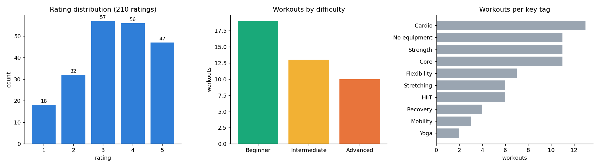
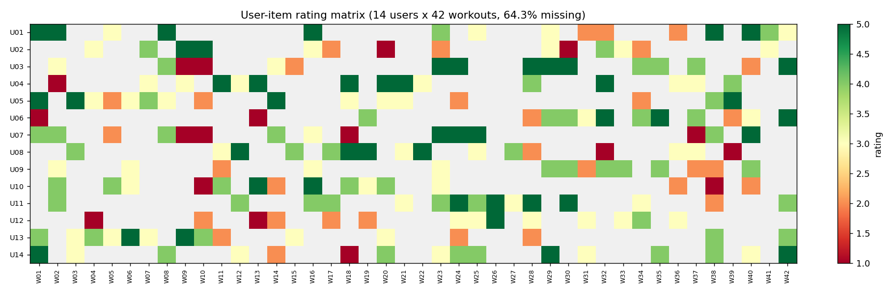
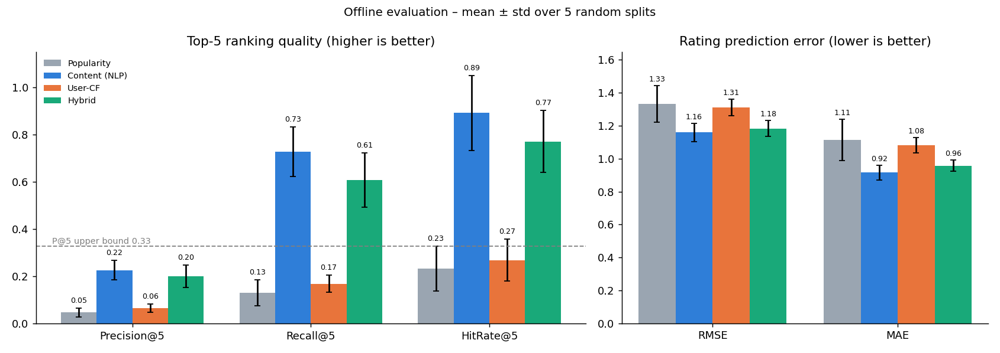
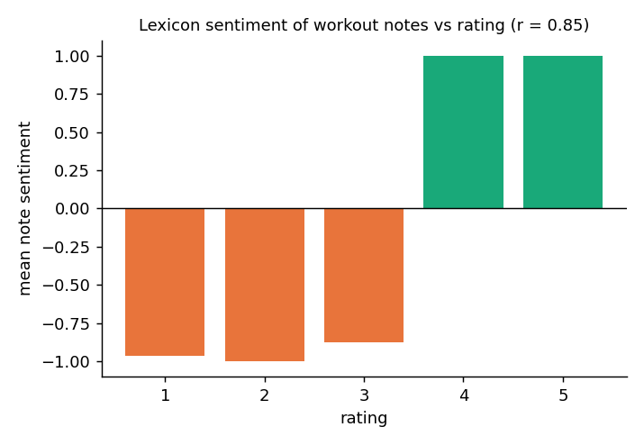

# Fitness Workout and Training Plan Recommender

**CS467 Advanced Artificial Intelligence – Assignment 15 (Individual Mini-Project), Duy Tan University 2026-2027**

| Field | Details |
|---|---|
| Student name | Hà Văn Quốc Tiến |
| Student ID | 29211355728 |
| Section | CS467A (No. 16) |
| Instructor | Puri Vikram |
| Project code | MP-A16 |
| Project title | Fitness Workout and Training Plan Recommender |
| Domain | Health and Fitness Apps |

---

## 1. Problem statement

Fitness app users want different things. Some want fat loss, some want strength, some want flexibility. They also have different time limits and different equipment at home. A fixed "top workouts" list ignores all of that. This project builds a small Python recommender that:

1. Understands **natural-language requests** such as *"20 minute home cardio workout with no equipment"* (NLP + TF-IDF).
2. Learns each user's taste from their **workout ratings and notes** (rating-weighted text profile, user-based collaborative filtering).
3. Handles **brand-new users** who only type one sentence about their goal (cold start).

It compares three course methods: a **popularity baseline**, an **NLP content-based** recommender and **user-based collaborative filtering**. A small **hybrid** of the last two is included as a bonus.

## 2. Dataset (`data/`)

| File | Rows | Columns |
|---|---|---|
| `items.csv` | 42 workouts | `item_id, workout_name, difficulty, duration_min, description, target_muscles_tags` |
| `ratings.csv` | 210 ratings from 14 users | `user_id, item_id, rating [1-5], workout_note` |

* **Workouts:** cardio, HIIT, running, strength (bodyweight, dumbbells, barbell, machines), core, stretching, yoga, mobility and recovery. There are 19 Beginner, 13 Intermediate and 10 Advanced workouts, each 10–60 minutes long. Each has a hand-written description and `;`-separated muscle/equipment/location tags (for example `core;abs;bodyweight;home;yoga_mat`).
* **Users and ratings:** each user rated 14–16 workouts (≥ 4–6 required) and each workout has 2–8 ratings. The user-item matrix is **64.3 % empty** (target 40–65 %). Every rating has a short note such as *"Loved it, the core work felt amazing."*
* **Source:** the dataset is **self-created and synthetic**. The workout descriptions were written by hand. The ratings and notes were simulated from 14 user personas (home cardio beginner, runner, core & stretching fan, powerlifter, HIIT fan, yogi, busy office worker, bodybuilder, senior, gym beginner, calisthenics, back rehab, cyclist, core+mobility). A user rates workouts whose tags match their likes higher, and workouts with tags they dislike lower, plus random noise. The script is `data/generate_ratings.py` (fixed seed, so it reproduces `ratings.csv` exactly). No external dataset was used.




## 3. Methods

### 3.1 NLP pipeline (`src/nlp_pipeline.py`)

| Step | What it does |
|---|---|
| Cleaning | lowercase; remove punctuation, bare numbers and extra spaces |
| Phrase normalisation | joins fitness expressions into one token **before** stop-word removal: `no equipment / without weights / bodyweight` → `bodyweight`, `low impact` → `low_impact`, `full-body` → `full_body`, `lower back` → `lower_back`, `jump rope` → `jump_rope`, … (otherwise stop-word removal would drop the "no" in "no equipment") |
| Tokenisation + stop-words | scikit-learn English stop-words + domain stop-words (`workout`, `routine`, `minute`, `want`, …) |
| Lemmatisation | small rule-based plural → singular (`stretches` → `stretch`, `legs` → `leg`) |
| Synonyms | `abdominal/ab` → `abs`, `stretch` → `stretching`, `jog/run` → `running`, `tabata/interval` → `hiit`, `relax` → `relaxation`, `apartment` → `home`, … |
| Item document | name + description + tags ×2 (tags get more weight) + difficulty |
| TF-IDF | `TfidfVectorizer(ngram_range=(1,2), sublinear_tf=True)` fitted on the 42 item documents → 42 × 1055 matrix |
| Query vectorisation | `FitnessNLP.transform(text)` runs any new query or description through the **same** pipeline and fitted vocabulary |
| User fitness profile | `w_i = (rating_i − 3) + 0.5·sentiment(note_i)`; `profile = L2norm(max(0, Σ w_i · tfidf_i))`. Workouts rated above neutral pull the profile toward their terms; workouts rated low push it away. |
| Helpers | `top_keywords` (terms with the largest contribution `q_t · d_t` to the cosine), `extract_constraints` (duration and difficulty from text, e.g. "20 minute", "half an hour", "beginner"), `note_sentiment` (lexicon score in [-1, 1]) |

### 3.2 Recommenders (`src/recommender.py`)

All methods skip workouts the user already rated and return Top-5 with a score and a short **why** explanation.

1. **Popularity baseline:** Bayesian average `(n·mean + m·global_mean)/(n + m)` with `m = 3`. Only workouts with **≥ 3 ratings** are ranked.
2. **NLP content-based:** cosine similarity between TF-IDF vectors.
   * (a) item-to-item (`--item W23`) and user profile → items;
   * (b) free-text query → items. When the query states a duration or level, `score = 0.8·cosine + 0.1·duration_fit + 0.1·level_fit`, where `duration_fit = max(0, 1 − |d − target| / target)`.
   * Rating prediction for RMSE: item-kNN, `r̂ = μ_u + Σ sim·(r − μ_u) / Σ sim` over the 5 most text-similar workouts the user has rated.
3. **User-based collaborative filtering (project extension):**
   * Similarity: mean-centred cosine (Pearson-like) over co-rated workouts, needing ≥ 3 co-rated items. It is multiplied by `min(n, 5)/5` (significance weighting).
   * Prediction: `r̂ = μ_u + Σ s·(r_v − μ_v) / (Σ|s| + λ)` over the k = 5 most similar positive neighbours who rated the item. The damping term λ = 1 pulls the prediction toward the user's mean when there is little evidence.
4. **Hybrid (bonus):** `0.5·minmax(CF prediction) + 0.5·minmax(content cosine)`.
5. **Cold start:** `0.85·query score + 0.15·popularity prior`. It only needs one sentence from the user.

## 4. Installation and run commands

```bash
git clone https://github.com/<your-github-username>/cs467-miniproject-29211355728.git
cd cs467-miniproject-29211355728
python -m venv venv && source venv/bin/activate        # Windows: venv\Scripts\activate
pip install -r requirements.txt

python src/main.py                                      # 3 required test cases -> results/sample_outputs.txt
python src/main.py --query "30 min beginner yoga for flexibility"
python src/main.py --user U05 --method all              # methods: all | content | cf | hybrid | popularity
python src/main.py --item W23                           # "because you liked ..."
python src/main.py --cold "I want to get stronger at home with dumbbells"
python src/main.py --interactive                        # type user IDs / item IDs / 'cold: <goal>' / any text
python src/main.py --evaluate                           # same as: python src/evaluate.py (metrics + charts)
```

There is also an optional walkthrough notebook at `notebooks/demo.ipynb` (run it from inside `notebooks/`). Tested with Python 3.13, numpy 2.5, pandas 3.0, scikit-learn 1.9 and matplotlib 3.11.

## 5. Sample outputs – the 3 required test cases

The full output is in [`results/sample_outputs.txt`](results/sample_outputs.txt).

### Test case 1 – Goal query: "20 minute home cardio workout with no equipment"

```
NLP tokens  : ['home', 'cardio', 'bodyweight']        Constraints: duration = 20 min
#  ID   Workout                          Level        Min    score  Why (top keywords / evidence)
1  W38  Lunch Break Express Circuit      Intermediate  15    0.296  cardio bodyweight, home, 15 min
2  W08  Dance Cardio Party               Beginner      30    0.236  home cardio, bodyweight
3  W01  Bodyweight HIIT Blast            Intermediate  20    0.216  bodyweight, home, cardio, 20 min
4  W02  Beginner Low-Impact Cardio       Beginner      20    0.209  cardio, bodyweight, home, 20 min
5  W41  Stair Climb Cardio               Intermediate  20    0.190  cardio, bodyweight, 20 min
```
All five are cardio workouts that need no equipment and take 15–30 minutes. Phrase normalisation turned "no equipment" into the `bodyweight` token, and that token is what matches these workouts.

### Test case 2 – Personal history: user U03 (rated core and stretching routines highly)

U03 gave 5★ to Core Crusher, Pilates Core, Full-Body Stretching, Hanging Leg Raise Abs, Core & Stretch Combo and Morning Yoga Flow. They gave 1★ to both running workouts. Their profile's top terms are `yoga_mat, abs, flexibility, core, stretching`.

```
NLP content-based (cosine with user profile)
1  W32  Post-Run Cooldown Stretch        Beginner      10    0.127  stretching, flexibility, recovery
2  W25  Plank Variations Challenge       Intermediate  15    0.127  core, plank, home
3  W31  Hip Mobility for Desk Workers    Beginner      15    0.117  stretching, yoga_mat, hip
4  W26  Lower Back and Core Stability    Beginner      20    0.112  core, yoga_mat, bodyweight
5  W16  Glute Bridge and Leg Burner      Beginner      20    0.088  home, bodyweight home, home beginner

User-based CF (predicted rating)
1  W26  Lower Back and Core Stability    4.577  liked by similar users U11(5*), U12(5*)
2  W32  Post-Run Cooldown Stretch        4.246  liked by similar users U06(5*), U04(5*), U09(4*)
3  W20  Machine Circuit for Beginners    4.112  liked by similar users U10(4*), U14(4*), U04(5*)
4  W16  Glute Bridge and Leg Burner      4.052  ...
5  W25  Plank Variations Challenge       4.050  ...

Hybrid:      W26, W32, W25, W16, W31
Popularity:  W01 Bodyweight HIIT Blast, W16, W12 Push-Ups, W03 Jump Rope, W25   <- not personalised
```
Content-based and the hybrid recommend core and stretching workouts. Popularity recommends HIIT and jump rope, which this user does not like.

### Test case 3 – Cold start: "I'm a beginner with a stiff lower back and I want to get more flexible."

```
NLP tokens : ['beginner', 'stiff', 'lower_back', 'flexibility']     Constraints: difficulty = Beginner
1  W26  Lower Back and Core Stability    Beginner  20   0.370  lower_back, beginner | pop 4.03
2  W29  Full-Body Stretching Routine     Beginner  20   0.285  flexibility, beginner | pop 3.80
3  W31  Hip Mobility for Desk Workers    Beginner  15   0.278  lower_back, beginner | pop 2.90
4  W42  Core and Stretch Combo           Beginner  30   0.276  flexibility, beginner | pop 4.02
5  W35  Bedtime Relaxation Stretch       Beginner  15   0.272  flexibility, beginner | pop 3.88
```
There is no rating history and CF cannot work here, but one sentence is enough to get relevant beginner back and flexibility workouts. Without personalisation, the popularity list would include the HIIT Blast (Intermediate).

## 6. Evaluation (`src/evaluate.py`)

**Protocol:**
* For each user, 3 random ratings (≈ 20 %) are hidden. That gives 42 test ratings per split.
* Each method ranks every workout the user has not rated in training.
* A hidden workout is **relevant** if its rating is ≥ 4.
* Everything is repeated over **5 random splits**, and the table shows mean ± std.
* With only 3 hidden ratings per user, the best possible Precision@5 is **0.326**.

| Method | Precision@5 | Recall@5 | HitRate@5 | RMSE | MAE |
|---|---|---|---|---|---|
| Popularity | 0.046 ± 0.019 | 0.129 ± 0.055 | 0.232 ± 0.094 | 1.333 ± 0.111 | 1.114 ± 0.126 |
| **Content (NLP)** | **0.225 ± 0.040** | **0.727 ± 0.106** | **0.891 ± 0.159** | **1.159 ± 0.056** | **0.915 ± 0.045** |
| User-CF | 0.064 ± 0.017 | 0.168 ± 0.037 | 0.267 ± 0.089 | 1.310 ± 0.050 | 1.082 ± 0.045 |
| Hybrid (CF + content) | 0.198 ± 0.048 | 0.607 ± 0.115 | 0.769 ± 0.131 | 1.182 ± 0.048 | 0.958 ± 0.034 |



**Analysis**
* **NLP content-based is clearly the best.** It reaches 69 % of the best possible Precision@5 (0.225 / 0.326) and finds at least one liked hidden workout for 89 % of users. Workout text and tags describe what a user likes very well.
* **User-based CF is only a little better than popularity for ranking.** For rating prediction it is about as good as predicting the user's own mean rating (RMSE ≈ 1.31). With 14 users and about 12 training ratings each, two users usually share only 2–4 rated workouts, so the similarities are noisy. For example, the HIIT fan U05 gets "Senior Balance and Strength" as a CF recommendation. The damping term keeps CF safe, but it cannot create information that is not in the data.
* **The hybrid** is much better than CF and popularity, but slightly worse than pure content-based on this small dataset. With more users, the CF half should start to help.
* **Sensitivity check** (content P@5 over the same 5 splits): unigrams vs 1–2-grams and tag weight 1/2/3 all give 0.217–0.233. These differences are inside one standard deviation, so 1–2-grams were kept because they give more readable explanations (`home cardio`).
* **Note sentiment:** the lexicon sentiment of notes correlates strongly with the rating (r = 0.85, `results/sentiment_vs_rating.png`). This is partly because the notes were simulated from the ratings. Sentiment is therefore used only as a small adjustment (0.5) in the profile weights.



## 7. Reflection

**What worked well**
* Domain phrase normalisation and synonyms mattered more than any TF-IDF setting. Without them, "no equipment" loses the word "no", and "abs" and "abdominal" would never match.
* Parsing duration and difficulty from the query gives practical results (a 20-minute request returns mostly 15–20-minute workouts) without hard filters that could return nothing.
* Every recommendation comes with an explanation (matching keywords, similar users, or popularity evidence), which makes the results easy to check and to present.
* Evaluating over 5 splits with an upper bound shows how noisy a single split of 42 test ratings is (std up to 0.16).

**Limitations and future work**
* The ratings are synthetic and come from tag-based personas. This favours content-based methods, so real users would be noisier.
* The dataset is tiny (14 users), which is the main reason CF is weak. Item-based CF or matrix factorisation would need more data.
* TF-IDF only matches words, not meaning. "Get my heart rate up" does not match `cardio` unless it is in the synonym list. Sentence embeddings (e.g. SBERT) would help.
* The duration rule only rewards closeness to the target, and the sentiment lexicon is very small. Real user notes would need a trained sentiment model.
* Future work: a weekly training plan (rotate muscle groups and rest days), safety rules (injuries, senior users), and online learning from new feedback ratings.

## 8. Project structure

```
cs467-miniproject-29211355728/
|-- README.md
|-- requirements.txt
|-- .gitignore
|-- data/
|   |-- items.csv              42 workouts with descriptions and tags
|   |-- ratings.csv            210 ratings + workout notes (14 users)
|   +-- generate_ratings.py    persona-based generator used to create ratings.csv
|-- src/
|   |-- nlp_pipeline.py        cleaning, TF-IDF, user profiles, keywords, constraints, sentiment
|   |-- recommender.py         popularity, content-based, user-CF, hybrid, cold start
|   |-- evaluate.py            train/test evaluation + charts
|   +-- main.py                CLI demo
|-- notebooks/
|   +-- demo.ipynb             interactive walkthrough
+-- results/
    |-- sample_outputs.txt     output of the 3 test cases
    |-- evaluation_results.csv / evaluation_per_seed.csv
    +-- data_overview.png, user_item_matrix.png, evaluation_comparison.png, sentiment_vs_rating.png
```

## References
* Course material: CS467 lectures on NLP (text preprocessing, TF-IDF) and recommender systems (popularity, content-based, collaborative filtering).
* scikit-learn documentation: `TfidfVectorizer`, `cosine_similarity`.
* Herlocker et al. (1999), *An Algorithmic Framework for Performing Collaborative Filtering*: significance weighting for neighbour similarity.
